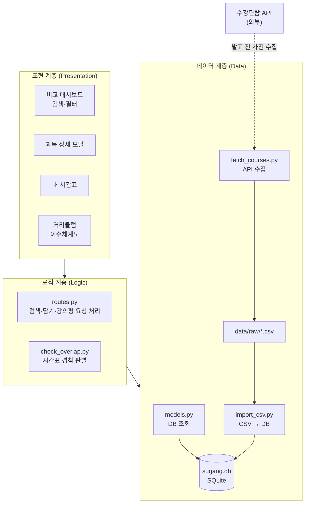

# Week 07 팀 활동지 / Team Activity

| 팀명 / Team | 작성일 / Date | 참여자 / Members |
|---|---|---|
| team12 | 26-10-14 | 김명준,김준석,정찬영 |

## 1. 아키텍처 다이어그램 / Architecture Diagram

## 아키텍처

| 계층 / Layer | 모듈·파일 / Modules | 의존하지 않는 것 / Does not depend on |
|---|---|---|
| 표현 / Presentation | `frontend/` : 로그인, 비교 대시보드(검색·필터), 과목 상세 모달, 내 시간표, 커리큘럼(이수체계도) 화면 | DB 파일(`sugang.db`), CSV 파일, 수강편람 API, SQL |
| 로직 / Logic | `routes.py` (검색·필터·담기·강의평 요청 처리), `overlap.py` (시간표 겹침 판별) | 화면 구성(HTML/CSS), CSV 파일, 수강편람 API, 데이터 수집 스크립트 |
| 데이터 / Data | `models.py` (DB 조회), `init_db.py` (DB 생성), `import_csv.py` (CSV → DB) | 화면(`frontend/`), 시간표 겹침 로직 |

## 2. 이슈 / Issues

> 이슈 = **앞으로 할 일** / An issue is work to be done.
> 개발할 때 커밋에 이슈 번호를 붙이고(`#3 알레르기 필터 추가`), 완료 조건을 만족하면 이슈를 닫습니다.
> Add the issue number to commits, and close the issue when its criteria are met.

| # | 제목 / Title | 라벨 / Label | 담당 / Assignee | 완료 조건 / Acceptance Criteria |
|---|---|---|---|---|
| 예시 #3 | 알레르기 필터 | backend | 홍길동 | '땅콩'을 선택하면 땅콩이 들어간 메뉴가 추천 결과에서 빠진다 |
| | | | | |
| | | | | |
| | | | | |

## 3. 마일스톤 / Milestones

| 마일스톤 / Milestone | 마감 / Due | 포함 이슈 / Issues |
|---|---|---|
| MVP 완료 | 11주차 | |
| 실행 패키지 | 13주차 | |

> AI를 사용했다면 `PROMPTS.md`에 기록 / Log any AI use in `PROMPTS.md`
