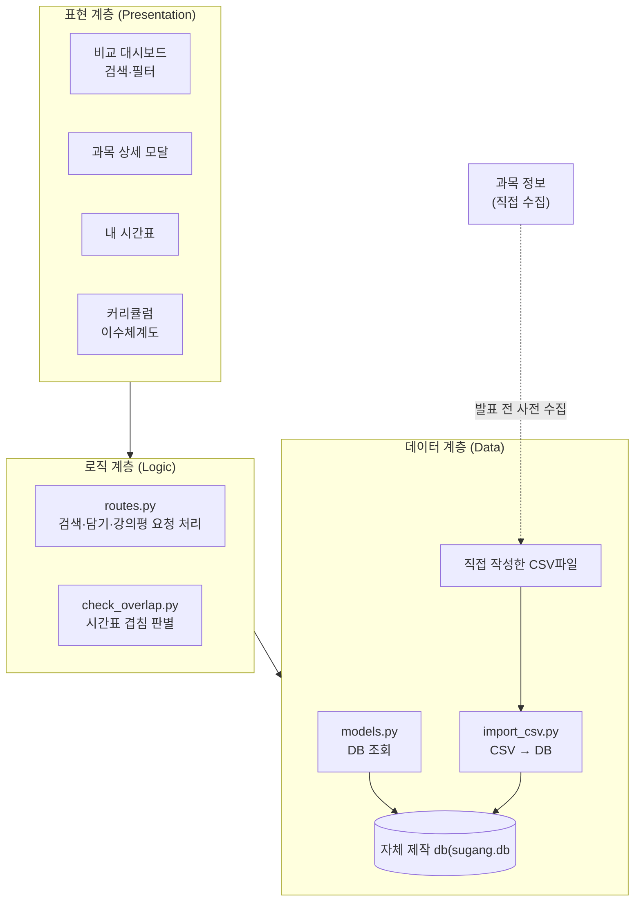

# Week 07 팀 활동지 / Team Activity

| 팀명 / Team | 작성일 / Date | 참여자 / Members |
|---|---|---|
| team12 | 26-10-14 | 김명준,김준석,정찬영 |

## 1. 아키텍처 다이어그램 / Architecture Diagram

## 아키텍처

| 계층 / Layer | 모듈·파일 / Modules | 의존하지 않는 것 / Does not depend on |
|---|---|---|
| 표현 / Presentation | `frontend/` : 로그인, 비교 대시보드(검색·필터), 과목 상세 모달, 내 시간표, 커리큘럼(이수체계도) 화면 | DB 파일(`sugang.db`), CSV 파일, 수강편람 API, SQL |
| 로직 / Logic | `routes.py` (검색·필터·담기·강의평 요청 처리), `overlap.py` (시간표 겹침 판별) | 화면 구성(HTML/CSS), CSV 파일, 수강편람 API, 데이터 수집 스크립트 |
| 데이터 / Data | `models.py` (DB 조회), `init_db.py` (DB 생성), `import_csv.py` (CSV → DB) | 화면(`frontend/`), 시간표 겹침 로직 |

## 2. 이슈 / Issues

> 이슈 = **앞으로 할 일** / An issue is work to be done.
> 개발할 때 커밋에 이슈 번호를 붙이고(`#3 알레르기 필터 추가`), 완료 조건을 만족하면 이슈를 닫습니다.
> Add the issue number to commits, and close the issue when its criteria are met.

| # | 제목 / Title | 라벨 / Label | 담당 / Assignee | 완료 조건 / Acceptance Criteria |
|---|---|---|---|---|
| 1 | DB 스키마 설계 | db | | 테이블별 설명이 담긴 스키마 문서가 저장소에 올라간다 |
| 2 | DB 생성 기능 구현 | backend | | 실행하면 DB 파일이 만들어진다 |
| 3 | 과목 정보 수동 수집 | db | | 대상 학과의 과목 전체가 UTF-8 CSV로 저장된다 |
| 4 | CSV 데이터를 DB에 반영 | backend | | 여러 번 실행해도 같은 과목이 중복 없이 반영된다 |
| 5 | 수동 입력 데이터 작성 | db | | 강의평 더미와 선수과목 연계 데이터가 DB에서 조회된다 |
| 6 | 검색·필터 화면 연동 | frontend | | 과목명·요일·학점으로 검색하면 결과가 비교 표에 표시된다 |
| 7 | 시간표 겹침 판별 + 테스트 | backend | | 시간이 겹치는 과목은 담기가 막히고 경고 문구가 뜬다 |
| 8 | 과목 상세·내 시간표 화면 연동 | frontend | | 과목을 클릭하면 상세 정보와 강의평이 뜨고, 담은 과목이 시간표에 색으로 표시된다 |

## 3. 마일스톤 / Milestones

| 마일스톤 / Milestone | 마감 / Due | 포함 이슈 / Issues |
|---|---|---|
| MVP 완료 | 11주차 | |
| 실행 패키지 | 13주차 | |

> AI를 사용했다면 `PROMPTS.md`에 기록 / Log any AI use in `PROMPTS.md`
